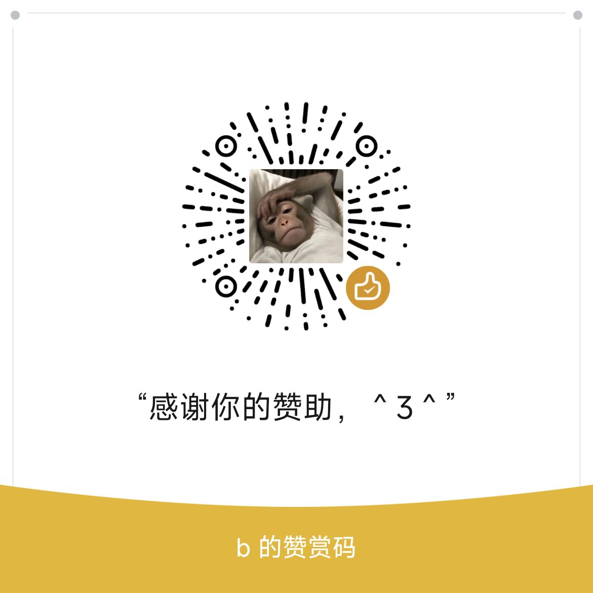

# 因为学校抢课太快以至于选到早八线下课，看网上并没有针对于郑州工商的抢课，自己抓包和用ai帮助下搞了这个项目并开源，当然README也是ai生成的，嘿嘿(*^▽^*)
# 不会了加QQ交流群：1128366507
# 郑州工商 选课余量巡逻（zzgs-course-watcher）

盯郑州工商学院教务系统（老版青果 KINGOSOFT 综合管理服务平台）的通识选修课网上选课，**一旦发现线上教学课程还有可选名额就立刻提示**：表格里加一行、响铃、往 `hits.log` 追加记录。

默认**只读**——它只告诉你"有空位了"，选课那一下还是你自己去网页上点。

> 这是个人学习用途的脚本，不是学校官方工具，也不获得学校任何授权。教务系统一改接口它就可能失效。
> 请只用于**你本人**的账号。**不得**用于登录他人账号、批量尝试凭证、或以任何方式影响他人正常使用教务系统。
> 因使用本项目造成的选课失误、账号被限制、学籍数据变更，由使用者本人承担。

---

## 环境

- Windows（界面按 Windows 写的，`taskkill`/`winsound` 等调用是 Windows 专用）
- Python 3.10+，只需要一个第三方库：`pip install requests`
- 图形界面用的是标准库自带的 Tkinter，不用再装东西

## 跑起来

```bash
python zzgs_gui.py        # 图形界面（推荐）
python zzgs_grab.py probe # 命令行：列一次现状
```

### 图形界面

1. 填学号、密码，点 **测试登录**（勾「记住账号密码」会写进同目录 `secret.txt`，公共电脑别勾）。
2. **列出现在有余量的课**：只读扫一遍全部课程，约 6 分钟，可中途停止。
3. **开始巡逻**：一轮一轮重扫，每轮重新拉课程池，所以以后新入池的课也能发现；状态栏显示轮次、池子数量、线上班数量、命中次数。

两个开关要看清：

| 开关 | 默认 | 影响 |
| --- | --- | --- |
| 只要线上教学课 | 开 | 判定口径：上课地点含「线上」，或任课教师列是「网络教师」 |
| 发现余量后自动提交选课 | **关** | 打开会**真实提交选课、改变学籍数据**，且可能选到你不想要的班 |

## 命令行

```bash
python zzgs_grab.py probe  --online --free     # 只打印当前有余量的线上课
python zzgs_grab.py watch  --online --rounds 0 # 一直巡逻，命中即提示
python zzgs_grab.py watch  --online --commit   # 出现余量时真正提交（会要求输入 yes 二次确认）
python zzgs_grab.py pick   --online --kcdm 21310014 --commit
```

常用参数：`--only 关键字`（课程名过滤）、`--targets 编号,编号`（只盯指定课，页面编号和后台 `kcdm` 都接受）、`--interval`（请求间隔，默认 2.4 秒）、`--rest`、`--retry`、`--cookie-file`、`--secret-file`。

## 内置的护栏

不是"建议"，是代码里写死的：

- **间隔下限 1.5 秒**，传更小直接退出。这是教务系统，几十人同时轰炸只会让所有人一起卡，也会被系统判为无效访问。
- **单实例互斥**：占用本机 `127.0.0.1:47821`，第二个实例会被拦住并提示"已经开着一个了"。
- **写操作要二次确认**：`--commit` 需要手动输入 `yes`，GUI 打开自动提交时会再弹一次确认框。
- **命中后默认停下**，不做连打，避免持续敲服务器。
- 凭证只读写**同目录的本地文件**（`secret.txt`、`cookies.txt`），不上传、不打印正文；日志里出现学号时走 `mask()` 掩码（输入框本身是明文，方便你自己核对）。

## 凭据与登录

- 自动登录：同目录 `secret.txt`，一行 `学号:密码`。
- 学校如果开启了验证码，自动登录会失败。改为在浏览器手动登录后，把 `JSESSIONID` 写进同目录 `cookies.txt`（一行 `JSESSIONID=xxx`），程序会优先使用它；缺点是会话过期后要自己更新。
- **一个账号只认一个在线会话**：网页教务系统和程序同时登录同一个学号会互相踢下线，表现为 HTTP 200 但内容里是 `alert('凭证已失效，请重新登录')`。一次只留一个。

## 接口是怎么读的

| 用途 | 位置 |
| --- | --- |
| 选课列表页 | `/student/wsxk.zx.html`，数据表 `taglib/DataTable.jsp?tableId=2568` |
| 某门课的班级表 | `tableId=6142`，取「可选人数」`kxrs` 作为余量 |
| 选课时间范围 | `/jw/common/getWsxkTimeRange.action` |
| 提交选课 | `/jw/common/saveElectiveCourse.action` |
| 登录 | `/cas/logon.action` |

三个坑（都是实测踩出来的，代码里已处理）：

- 请求必须带 `kcfw=zxggrx`（来自选课时间范围接口）。缺它时 2568/6142 一律返回 0 行，很容易被误判成"没开课"。
- 页面上显示的编号 `[51220030]` 和后台真实 `kcdm`（如 `21310014`）是两套，本项目两种都接受。
- 课程表和班级表的 `<td name>` 与表头 `id="head_xxx"` 同名，所以按**列名**取值，不按位置——教务系统调表格顺序不影响本项目。
- 线上课不能只匹配「网络」二字，会把「综合实验楼404（网络安全实验室）」的线下课误判进来。

## 公告与版本提醒

`zzgs_gui.py` 顶部两个常量：

```python
APP_VERSION = "1.3"
META_URL = ""   # 留空 = 不联网，只读同目录 公告.txt
```

`META_URL` 指向一个 `version.json`（发布者自己托管即可），字段：

```json
{ "version": "1.4", "url": "下载地址", "notice": "黄条文字",
  "notice_until": "2026-10-31", "popup": false }
```

- 拉取在后台线程、3 秒超时、失败一律静默。**公告挂了不会连累程序启动**，这是故意设计的。
- `version` 比本机 `APP_VERSION` 大时弹一次更新提示，同版本只提醒一次（状态写在本机 `update_state.txt`）。
- 版本号只按数字段比较，`1.10 > 1.2`；别写 `1.3-beta` 这类带字母的，会被解析成与 `1.3` 相同。

## 自测

```bash
python gui_selftest.py
```

7 个场景（A–G），**零网络、零真实账号**：全满不命中、放 3 个空位应命中并停下、自动提交开关是否真的调用 submit、列余量输出、空密码拦截、公告条与更新提醒、同版本不重复弹。改动代码后请先跑这个。

## 打包成 exe（可选）

```bash
pip install pyinstaller
pyinstaller --noconfirm --onefile --windowed --name zzgs-course-watcher zzgs_gui.py
```

`--windowed` 表示双击时不带黑色控制台窗口，代价是 `sys.stdout` 为空，所以底层日志通过 `Kingo(sink=...)` 回调送进界面。
另外注意：打包后 `__file__` 指向临时解包目录，配置路径必须用 `sys.executable` 的目录，否则 `secret.txt`、`cookies.txt`、`hits.log` 会写进 `%TEMP%` 并消失。

仓库里的 `make_release.py` 是**作者自用**的出包脚本，依赖作者本机的目录结构（同上一级的 `.venv`、以及仓库外的两份同学版说明文档），clone 下来直接跑会报缺文件——请用上面的 `pyinstaller` 命令。

## 已知问题

- 教务系统前端用同步 XHR 取加密密钥，服务器一慢浏览器标签页会整个冻结（实测完成 18.56 秒）。本项目走纯 HTTP，不受这个影响。
- 响应字符集是 GBK，`JSESSIONID` 带 `HttpOnly`，所以浏览器 DevTools 要从**请求标头**里复制，`document.cookie` 取不到。
- 断网或学校晚上关站是正常现象：巡逻每约 90 秒重试一轮，连续 20 轮连不上才退出（命令行可用 `--retry` 改这个间隔）。

## 许可

GPL-3.0，见 `LICENSE`。用 GPL 是为了让任何衍生版本也必须开源——但这不构成对使用方式的额外约束：**登录他人账号在任何情况下都是不被允许的，与许可证无关。**
## 赞赏
如果它帮你省下了时间，可以请我一杯奶茶（完全自愿，不赞赏不影响使用）

<div align="center">
  
  
</div>
